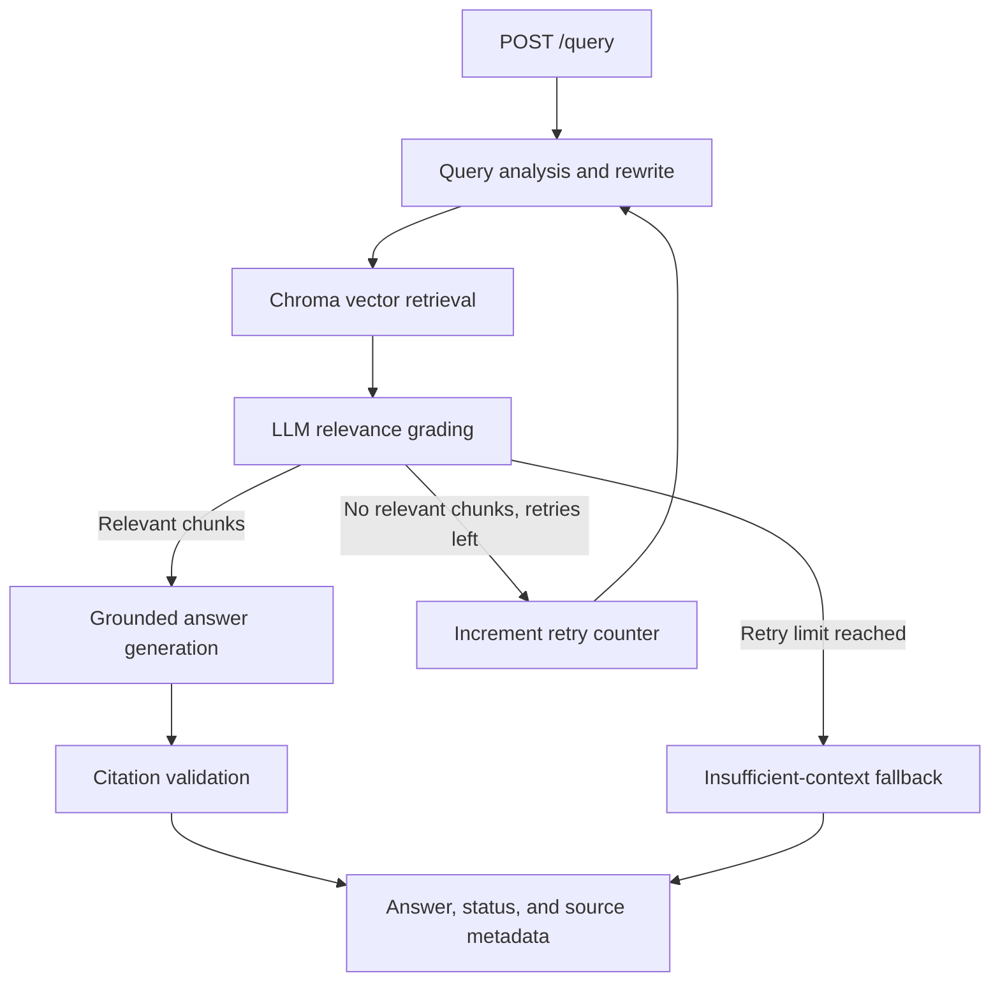

# RAG-Based Technical Documentation Assistant

Margin is a local documentation workspace with a polished browser interface and a FastAPI service behind it. Ask questions in plain language, inspect supporting passages, add files or public documentation pages, and keep a local searchable library. The retrieval workflow uses **Python, FastAPI, LangGraph, ChromaDB, Sentence Transformers, and Google Gemini**.

## Implemented features

- **Document ingestion:** local Markdown, text, and HTML documents; public HTTP(S) documentation URLs; multipart file upload.
- **Chunking and embeddings:** `RecursiveCharacterTextSplitter` and local `sentence-transformers/all-MiniLM-L6-v2` embeddings.
- **Persistent vector index:** ChromaDB stored in `data/chroma/`.
- **Self-corrective LangGraph workflow:** query analysis/rewrite → vector retrieval → per-chunk relevance grading → grounded generation → citation validation. If grading finds no useful chunks, the graph retries up to `MAX_RETRIES` and then returns an insufficient-context response.
- **Grounding controls:** generation is told to use only retrieved documentation; generated source references are checked against available source chunks.
- **Browser interface:** a focused question workspace, source previews, library view, file upload, public URL import, and answer feedback. The root URL opens the interface; `/docs` remains available for API testing.
- **FastAPI endpoints:** query, URL ingestion, file ingestion, local re-indexing, document listing, health check, and feedback collection.
- **Repeatable smoke evaluation:** five question cases, including an out-of-corpus question.
- **Automated tests:** request schema validation tests.

## Architecture



## Requirements

- Python **3.12** recommended (also target-compatible with Python 3.11).
- A Google AI Studio API key with access to the configured Gemini model.
- Internet access for package installation and the first download of the local embedding model.
- Windows PowerShell, macOS Terminal, or Linux shell.

## Setup on Windows

Open PowerShell in the project root directory.

1. Create and activate a virtual environment:

   ```powershell
   py -3.12 -m venv .venv
   .\.venv\Scripts\Activate.ps1
   ```

   If activation is blocked for this terminal, run `Set-ExecutionPolicy -Scope Process -ExecutionPolicy Bypass`, then activate again. You can also run the virtual environment's Python executable directly.

2. Install dependencies:

   ```powershell
   python -m pip install --upgrade pip
   pip install -r requirements.txt
   ```

3. Create your private environment file:

   ```powershell
   Copy-Item .env.example .env
   ```

   Edit `.env` and replace `replace_with_your_key` with your own API key. **Never commit `.env` or expose your API key.**

4. Start the API:

   ```powershell
   uvicorn app.main:app --reload
   ```

5. Open the app interface: <http://127.0.0.1:8000>

6. Follow the first-use steps below. Open Swagger UI at <http://127.0.0.1:8000/docs> only if you want to call the API directly.

### First use in the browser

1. Open **Add documents**. Upload `.md`, `.txt`, or `.html` files, or enter a public documentation URL. Files are limited to 2 MB each.
2. Wait for the success message. The app saves the source and builds the searchable index automatically; the first build may take a few minutes while the local embedding model downloads.
3. Open **Library** to confirm the saved documents appear.
4. Open **Ask**, type a question that can be answered from your documents, and select **Ask question**.
5. Read the answer and inspect the references underneath it. If the library does not contain enough information, add a better source or ask a narrower question.
6. Use **Rebuild library** only if you manually copied or edited files inside `data/documents` outside the browser interface.

The app stores the source library and feedback locally. Question text and retrieved passages are sent to Google Gemini for answer generation.

### First-time indexing from the command line

If you prefer to index the included documents directly, use:

   ```powershell
   Invoke-RestMethod -Method Post -Uri http://127.0.0.1:8000/ingest/local
   ```

   The first run downloads the embedding model, so ingestion may take a few minutes. The API key is needed for Gemini-powered query analysis, grading, and generation.

## API reference

### `POST /query`

Request:

```json
{
  "question": "How does LangGraph route to a fallback after retries?"
}
```

Response shape:

```json
{
  "question": "How does LangGraph route to a fallback after retries?",
  "answer": "The graph uses conditional edges to retry or fall back. [Source 1]",
  "sources": [
    {
      "source": "langgraph_stategraph.md",
      "chunk_id": "langgraph_stategraph.md-0-abc123",
      "preview": "LangGraph models a workflow as a graph..."
    }
  ],
  "retries": 0,
  "status": "answered"
}
```

The example values illustrate the response structure; actual answers and chunk IDs depend on retrieval. `status` is `answered` or `insufficient_context`.

### `POST /ingest`

Indexes local documents and any supplied public documentation URLs. The request body can be empty to re-index the local corpus, or include URLs:

```json
{
  "urls": [
    "https://fastapi.tiangolo.com/",
    "https://docs.langchain.com/oss/python/langgraph/overview"
  ]
}
```

The implementation accepts HTTP(S) URLs and rejects obvious localhost URLs and URL credentials. Only ingest trusted sources. For a production deployment, URL fetching should additionally enforce DNS/IP allowlists, redirect checks, response-size limits, and network egress rules.

### `POST /ingest/files`

Multipart form upload. Add one or more files using the field name `files`. Supported extensions are `.md`, `.txt`, and `.html`; each file is limited to 2 MB. Uploaded files are saved to `data/documents/`, then the local corpus is indexed.

### `POST /ingest/local`

Rebuilds the index from all Markdown, text, and HTML files currently under `data/documents/`.

### `GET /documents`

Returns document names, relative paths, sizes, and modification times for files stored in the corpus folder.

### `GET /health`

Returns basic service health and the configured retry limit. It does not prove that the vector collection or Gemini API is reachable.

### `POST /feedback`

Request:

```json
{
  "question": "How do I create a POST route?",
  "answer": "Use the @app.post decorator.",
  "rating": "up",
  "comment": "Helpful and clear"
}
```

`rating` must be `up` or `down`. Feedback is appended to `data/feedback.jsonl`. `GET /feedback` returns the saved records. This is local prototype storage, not a production database.

## Tests and evaluation

Run schema tests from the project root:

```powershell
python -m pytest -q
```

Start the API, index the local corpus, and run the smoke evaluation from a second terminal:

```powershell
python evaluation/run_eval.py
```

The evaluation sends five questions to the running API and checks response status, basic expected terms, and citations. It is a lightweight regression check, **not** a rigorous benchmark of retrieval recall or factual faithfulness. Results can vary with the LLM model and corpus; investigate and document any failed cases rather than changing expected results just to force a pass.

## Design choices and trade-offs

- **Embeddings:** the MiniLM sentence-transformer runs locally, avoiding a paid embedding API but requiring a one-time model download and local memory/CPU.
- **Chunking:** 900 characters with 150-character overlap is a pragmatic starting point. The separators prioritize headings and paragraphs, but chunking should be tuned to the documentation format.
- **Vector store:** ChromaDB is persistent and easy to run locally. Re-ingestion recreates the collection so removed or changed files do not leave stale chunks.
- **Relevance grading:** each retrieved chunk receives an LLM relevance judgment. This adds latency and model usage but helps avoid generating from keyword-only matches.
- **Self-correction:** retries are bounded to avoid an infinite graph loop. On retry, the query analysis prompt is instructed to broaden the search rather than repeat the failed query.
- **Citations:** source labels are passed to the generator and a validation node checks that citations exist and point to available source positions. This is a basic format check, not a guarantee that every claim is entailed by the cited text.
- **Fallback:** if no chunks pass grading after the retry limit, the service states that the indexed corpus is insufficient instead of making up an answer.
- **Feedback:** JSON Lines keeps the prototype easy to run. A deployed service should use a database, authentication, retention policies, and operational monitoring.

## Limitations and next steps

- The included corpus contains a few technical documentation files for local testing. For evaluation, add a representative, permission-cleared documentation set and describe what you tested.
- URL loading extracts readable HTML text. It is not a crawler and does not support authenticated pages, JavaScript-rendered content, or PDF parsing.
- Citation validation checks citation format and source-number bounds; it does not semantically verify every claim.
- The service is designed as a local internship prototype. Before production use, add authentication, rate limiting, request logging, stronger URL/DNS/redirect protections, upload quotas, concurrency controls, and durable feedback storage.
- The evaluation script is a smoke test. A stronger evaluation should track retrieval recall@k, citation precision, answer faithfulness, latency, and token/cost usage on a larger human-reviewed test set.

## Repository structure

```text
frontend/
  index.html         # Browser workspace
  styles.css         # Visual design and responsive layout
  app.js             # Browser interactions and API calls
app/
  config.py          # Settings and storage paths
  schemas.py         # Pydantic request/response models
  ingestion.py       # Loading, chunking, embeddings, and Chroma index
  graph.py           # LangGraph self-corrective RAG workflow
  main.py            # FastAPI routes
 data/documents/     # Documentation corpus
 evaluation/         # Evaluation cases and API smoke runner
 tests/              # Automated tests
 .env.example        # Environment variable template
 requirements.txt    # Python dependencies
```
